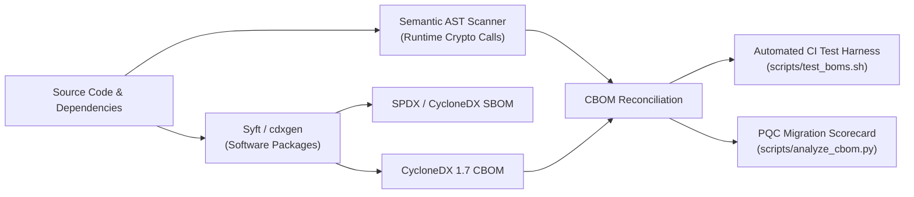
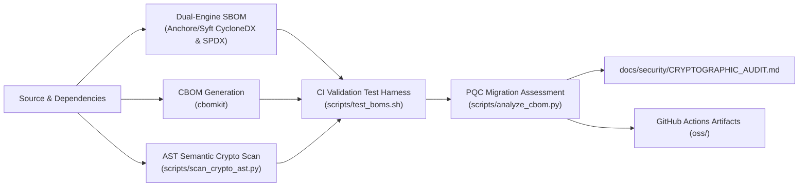

# Conjur Certificate Lifecycle Demo

## Overview

This repository contains a **working demonstration** of using **CyberArk Conjur** as a **policy‑controlled certificate issuance and renewal component** for internal workloads.

The demo shows how short‑lived X.509 certificates can be:
- Issued from CSRs
- Strongly bound to workload identity
- Automatically renewed
- Used for mutual TLS (mTLS)
- Governed through policy‑as‑code and audit logs

> ⚠️ **Important:**  
> This repository does **not** represent a full Certificate Lifecycle Management (CLM) platform.  
> It intentionally focuses on **issuance + renewal** for workloads, aligned to modern Zero Trust patterns.

---

## What This Demo Is (and Is Not)

### ✅ This demo **IS**
- A demonstration of **policy‑driven certificate issuance**
- A model for **short‑lived workload certificates**
- An example of **renewal‑based lifecycle control**
- Aligned to cloud‑native and service‑to‑service (mTLS) use cases
- Designed to be auditable and automation‑first

### ❌ This demo **IS NOT**
- A replacement for enterprise PKI
- A user or device certificate management solution
- A certificate discovery or inventory system
- A CRL or OCSP implementation
- A compliance or regulatory reporting platform

---

## Architectural Intent

The demo positions Conjur as:

> **An online, policy‑controlled intermediate CA for internal workload identity**

Key architectural principles demonstrated:

| Principle | Demo Behaviour |
|---------|---------------|
| Least privilege | Certificates issued only to authorised identities |
| Private key isolation | Keys generated and stored only by workloads |
| Short lifetimes | Certificates measured in hours, not months |
| Automation | Renewal replaces manual rotation |
| Governance | Control via identity, policy, and logs |

---

## High‑Level Architecture

```text
Workload A ──(CSR)──▶ CA Signer ──(Cert)──▶ Workload A
     │                                   │
     └───────────── mTLS ────────────────┘
                     ▼
                Workload B
```

## How the Demo Works

1. **Initialization (`init.sh`)**: The environment starts by cleanly generating a new local Demo Root CA and bringing up Conjur and a PostgreSQL database.
2. **Policy Loading**: A Conjur policy is automatically loaded, which defines namespaces, creates identities for `workload-a` and `workload-b`, and sets the permissions that authorize them to request certificates from the CA.
3. **Sidecar Execution**: The workloads (`workload-a` and `workload-b`) launch with a sidecar. Each sidecar:
   - Locally generates an RSA private key.
   - Generates a Certificate Signing Request (CSR) with the appropriate SPIFFE identity.
   - Authenticates directly with Conjur using its securely provided API Key.
   - Requests a signed certificate from the dedicated CA signer service.
   - Saves the signed certificate alongside the private key and then sleeps.
   - Wakes up to automatically renew the certificate before it expires.
4. **Mutual TLS**: 
   - `workload-b` (Server) runs a Flask API over HTTPS, configured to require client certificates. It verifies the client certificate against the Root CA.
   - `workload-a` (Client) continually makes HTTPS GET requests to `workload-b`. It uses its own generated client certificate to authenticate and verifies the server's identity against the Root CA.

## Running the Demo

You can run the demo either by building images locally from source or by pulling pre-built images from **GitHub Container Registry (ghcr.io)** or **Docker Hub**.

### Option A: Run Pre-Built Images with `run_docker.sh` (Recommended)

The [`run_docker.sh`](run_docker.sh) script automatically handles port validation, architecture detection (ARM64 / amd64), CA generation, Conjur initialization, policy loading, and mTLS verification:

```bash
# 1. Run using images from GitHub Container Registry (ghcr.io)
./run_docker.sh up --registry ghcr

# Or run using images from Docker Hub
./run_docker.sh up --registry dockerhub --user jsoehner

# 2. Verify mTLS connectivity between workloads
./run_docker.sh verify

# 3. View live logs or container status
./run_docker.sh status
./run_docker.sh logs

# 4. Clean up all containers, volumes, networks, and certificates
./run_docker.sh down
```

> **Note:** `docker-run.sh` is maintained as a backwards-compatible wrapper that forwards to `run_docker.sh`.

### Option B: Build and Run from Local Source (`init.sh`)

1. Execute the initialization script:
   ```bash
   bash init.sh
   ```
2. The script will output verbose statuses of each step as it builds and launches the environment.
3. Observe active mTLS traffic:
   ```bash
   docker compose logs -f workload-a workload-b
   ```

### Option C: Run via the Demo Orchestrator Container Image

The demo can also be executed directly using the standalone orchestrator image (`ghcr.io/jsoehner/conjur-demo:latest` or `jsoehner/conjur-demo:latest`):

```bash
docker run --rm -it \
  -v /var/run/docker.sock:/var/run/docker.sock \
  -p 8080:80 \
  -p 8443:8443 \
  -p 5001:5000 \
  ghcr.io/jsoehner/conjur-demo:latest up
```

### Expected Output

You should see output similar to the following, demonstrating the successful extraction of identity attributes from the newly minted certificates and the subsequent successful mTLS verification:

```text
workload-b-1  | [Sidecar] Certificate received and saved to /certs/tls.crt
workload-b-1  | [Sidecar] --- Certificate Attributes ---
workload-b-1  | [Server] Waiting for sidecar to provision certificates...
workload-b-1  | [Server] Certificates found. Starting mTLS server.
workload-b-1  | [Server] Listening on https://0.0.0.0:8443
workload-b-1  | [Sidecar] Subject : CN=workload-b
workload-b-1  | [Sidecar] Issuer  : CN=Demo-Root-CA
workload-b-1  | [Sidecar] Valid   : May 20 12:20:38 2026 GMT to May 21 12:20:38 2026 GMT
workload-b-1  | [Sidecar] SANs    : URI:spiffe://demo/workload-b,DNS:workload-b
workload-b-1  | [Sidecar] ------------------------------
workload-b-1  | [Sidecar] Sleeping before renewal check...
workload-a-1  | [Sidecar] Certificate received and saved to /certs/tls.crt
workload-a-1  | [Sidecar] --- Certificate Attributes ---
workload-a-1  | [Sidecar] Subject : CN=workload-a
workload-a-1  | [Sidecar] Issuer  : CN=Demo-Root-CA
workload-a-1  | [Sidecar] Valid   : May 20 12:20:39 2026 GMT to May 21 12:20:39 2026 GMT
workload-a-1  | [Sidecar] SANs    : URI:spiffe://demo/workload-a,DNS:workload-a
workload-a-1  | [Sidecar] ------------------------------
workload-a-1  | [Sidecar] Sleeping before renewal check...
workload-a-1  | [Client] Waiting for sidecar to provision certificates...
workload-a-1  | [Client] Certificates found. Starting mTLS client.
workload-a-1  | [Client] Attempting mTLS connection to Workload B...
workload-b-1  | 172.18.0.5 - - [20/May/2026 12:20:39] "GET / HTTP/1.1" 200 -
workload-a-1  | [Client] Response: 200 - Hello from Workload B! mTLS connection successful.
```

---

## Repository Governance & Supply Chain Security

This repository enforces the **Repository Governance Orchestrator** baseline to guarantee developer experience, commit hygiene, multi-layer security scanning, and dual-engine cryptographic supply chain visibility.

### 🛡️ Dual-Engine SBOM & CBOM Architecture

Manifest scanners alone cannot identify instantiated cryptographic algorithms in source code. This project implements a **dual-engine scanning architecture**:
1. **Manifest Engine (Syft / cdxgen)**: Inventories software packages and dependencies into SPDX (`oss/sbom.spdx.json`) and CycloneDX (`oss/cbom.json`).
2. **Semantic AST Engine (`scripts/scan_crypto_ast.py`)**: Traverses source code abstract syntax trees across Python, JS/TS, Go, Java, C/C++, Rust, and C# to identify runtime crypto call sites and automatically reconcile them into the CBOM.
3. **Automated CI Test Harness (`scripts/test_boms.sh`)**: Enforces 4 strict gates in CI and locally, failing builds if BOMs are missing, invalid, or contain zero cryptographic assets.



### 📊 Local BOM Generation & Verification

Generate and verify bill of materials locally:

```bash
# 1. Generate SBOM and CBOM with semantic AST reconciliation
bash scripts/generate_boms.sh .

# 2. Run automated validation test harness (4/4 gates)
bash scripts/test_boms.sh oss

# 3. Generate Post-Quantum Cryptography (PQC) markdown & JSON scorecards
python3 scripts/analyze_cbom.py oss/cbom.json \
  --markdown oss/crypto-summary.md \
  --json oss/crypto-analysis.json
```

### 🔒 Continuous Security & Governance Workflows

| Workflow | Purpose | Standards & Controls |
| :--- | :--- | :--- |
| [**`sbom-cbom.yml`**](.github/workflows/sbom-cbom.yml) | Dual-Engine SBOM & CBOM | Anchore/Syft, cbomkit, AST reconciliation, PQC migration audit |
| [**`security-testing.yml`**](.github/workflows/security-testing.yml) | Multi-Layer Security | Gitleaks (secrets), Semgrep (SAST OWASP Top 10), Trivy (filesystem & dependency CVEs) |
| [**`commit-lint.yml`**](.github/workflows/commit-lint.yml) | Commit Hygiene | Enforces [Conventional Commits](CONTRIBUTING.md#commit-message-guidelines) on all PRs and pushes |
| [**`changelog.yml`**](.github/workflows/changelog.yml) | Automated Releases | `git-cliff` automated `CHANGELOG.md` generation from commit messages |
| [**`docker-publish.yml`**](.github/workflows/docker-publish.yml) | Container Publishing | Multi-image container builds with Node 24 and immutable SHA-pinned actions |
| [**`nightly-updates.yml`**](.github/workflows/nightly-updates.yml) | Automated Maintenance | Nightly dependency upgrades verified by live mTLS container spin-up |

---

## Gotchas

* **Node 24 Modernization & Immutable SHA Pinning:** When GitHub Actions runners complain about Node 20 deprecation, simply bumping `@v4` or `@v7` is insufficient and exposes workflows to supply chain tampering. All GitHub Actions in this repository must use Node 24-compatible releases and be pinned to explicit 40-character commit SHAs (e.g., `actions/checkout@3d3c42e5aac5ba805825da76410c181273ba90b1 # v7.0.1`).
* **JSON Arguments for ENTRYPOINT/CMD in Dockerfiles:** Always use the JSON array format (e.g., `CMD ["sh", "-c", "script.sh & python app.py"]`) rather than the shell form in Dockerfiles. The shell form can cause unintended behavior related to OS signals, as it may prevent signals like `SIGTERM` from correctly propagating to the underlying processes when stopping the container.
* **Cryptographic Material File Permissions:** All private keys (`ca.key`, workload `tls.key`) must strictly use `600` permissions (`chmod 600`), and containers must execute as non-root users (`USER appuser`).

## 🛡️ Security & Cryptographic Posture

This project tracks Software & Cryptographic Bill of Materials (SBOM & CBOM) and Post-Quantum Cryptography (PQC) readiness. See the latest [Cryptographic Audit & PQC Migration Report](docs/security/CRYPTOGRAPHIC_AUDIT.md).

---

## Automated SBOM & CBOM Supply Chain Pipeline

This repository features an automated continuous supply chain security pipeline defined in [`.github/workflows/sbom-cbom.yml`](.github/workflows/sbom-cbom.yml). On every push, pull request, or tag release, the workflow executes a multi-stage generation, validation, and auditing process:



### CI Pipeline Stages

1. **Dual-Engine SBOM Generation**: Uses `anchore/sbom-action` to produce standard CycloneDX (`oss/sbom.cyclonedx.json`) and SPDX (`oss/sbom.spdx.json`) inventory files.
2. **Cryptographic Bill of Materials (CBOM)**: Uses `cbomkit/cbomkit-action` to discover cryptographic algorithms, certificates, keys, and cryptographic assets (`oss/cbom.json`).
3. **Dual-Engine AST Semantic Crypto Scan**: Executes `scripts/scan_crypto_ast.py` to parse source code abstract syntax trees (ASTs), mapping cryptographic call-sites and cipher initializations to the CBOM inventory.
4. **Automated Verification Harness**: Runs `scripts/test_boms.sh` to validate JSON schemas, verify required CycloneDX attributes, and enforce non-empty inventory thresholds as a build gate.
5. **Post-Quantum Cryptography (PQC) Assessment**: Runs `scripts/analyze_cbom.py` to classify cryptographic assets by quantum-readiness and output markdown summary dashboards to `$GITHUB_STEP_SUMMARY`.
6. **Continuous Governance Publishing**: Automatically syncs the latest cryptographic posture to [`docs/security/CRYPTOGRAPHIC_AUDIT.md`](docs/security/CRYPTOGRAPHIC_AUDIT.md) and publishes all BOM assets to workflow artifacts.

---

## Local Scripts & Verification

All pipeline stages can be executed locally in development environments using scripts in `scripts/`:

### 1. Generating BOMs (`scripts/generate_boms.sh`)

Generate SBOMs and CBOMs for either source directories or Docker container images:

```bash
# Scan current repository directory (outputs to oss/)
bash scripts/generate_boms.sh -t dir .

# Scan a local Docker image
bash scripts/generate_boms.sh -t docker conjur-demo:local

# Specify custom output directory and format
bash scripts/generate_boms.sh -t dir -o build/boms -f cyclonedx-json .
```

### 2. Testing & Validating BOMs (`scripts/test_boms.sh`)

Run automated JSON validation, schema verification, and inventory count checks:

```bash
bash scripts/test_boms.sh oss
```

### 3. Scanning Source AST for Crypto Callsites (`scripts/scan_crypto_ast.py`)

Scan Python and repository source code ASTs for cryptographic primitive invocations and reconcile with an existing CBOM:

```bash
python3 scripts/scan_crypto_ast.py . \
  --cbom oss/cbom.json \
  --output-json oss/crypto-callsites.json
```

### 4. PQC Readiness Analysis (`scripts/analyze_cbom.py`)

Analyze a generated CBOM against software dependencies and generate markdown or JSON risk summaries:

```bash
python3 scripts/analyze_cbom.py oss/cbom.json \
  --sbom oss/sbom.cyclonedx.json \
  --json oss/crypto-analysis.json \
  --markdown docs/security/CRYPTOGRAPHIC_AUDIT.md
```

### 5. OCI Artifact Attachment (`scripts/attach_oci_bom.sh` & `scripts/fetch_oci_cbom.py`)

Publish and retrieve CBOMs attached to OCI container registries:

```bash
# Attach CBOM to container image in registry
bash scripts/attach_oci_bom.sh oss/cbom.json my-registry.io/app:v1.0.0

# Fetch CBOM from container image
python3 scripts/fetch_oci_cbom.py my-registry.io/app:v1.0.0 --output-dir oss
```

---

## Architectural Decision Records (ADRs)

Key architectural decisions governing this repository's security, supply chain, and cryptography strategy are documented under [`docs/adr/`](docs/adr/):

- [**ADR-0001: Automated SBOM and CBOM Supply Chain Governance Pipeline**](docs/adr/0001-automated-sbom-cbom-supply-chain-governance.md) - Context, alternatives considered, decision rationale, and downstream consequences for adopting automated dual-engine SBOM/CBOM scanning, AST call-site analysis, and CI gate verification.
